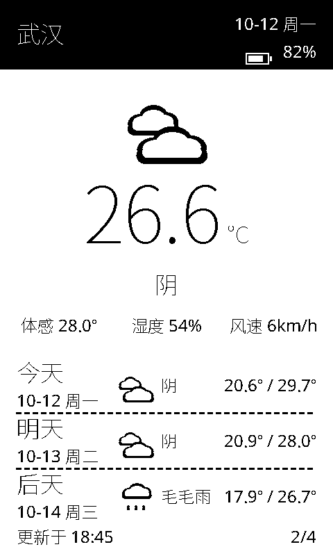
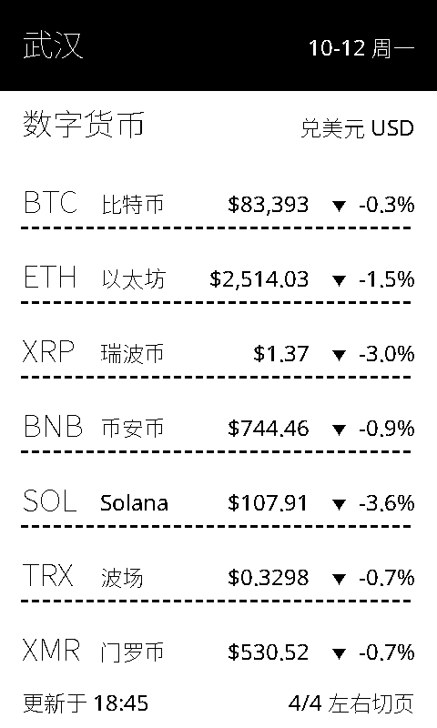
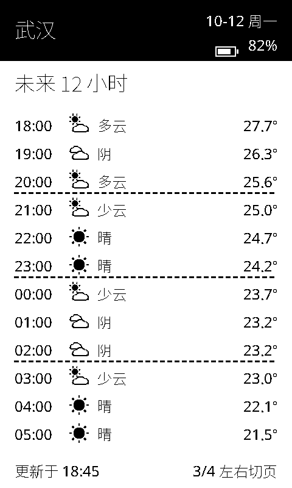
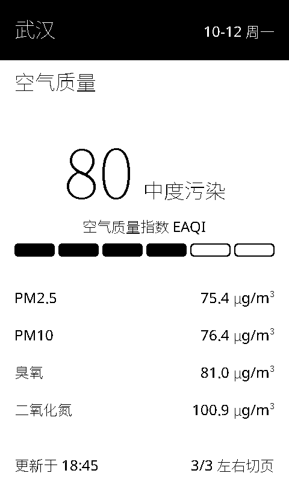
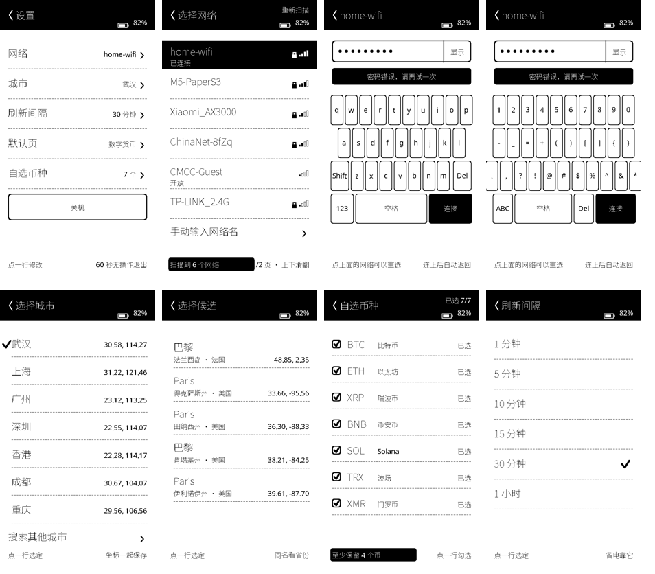
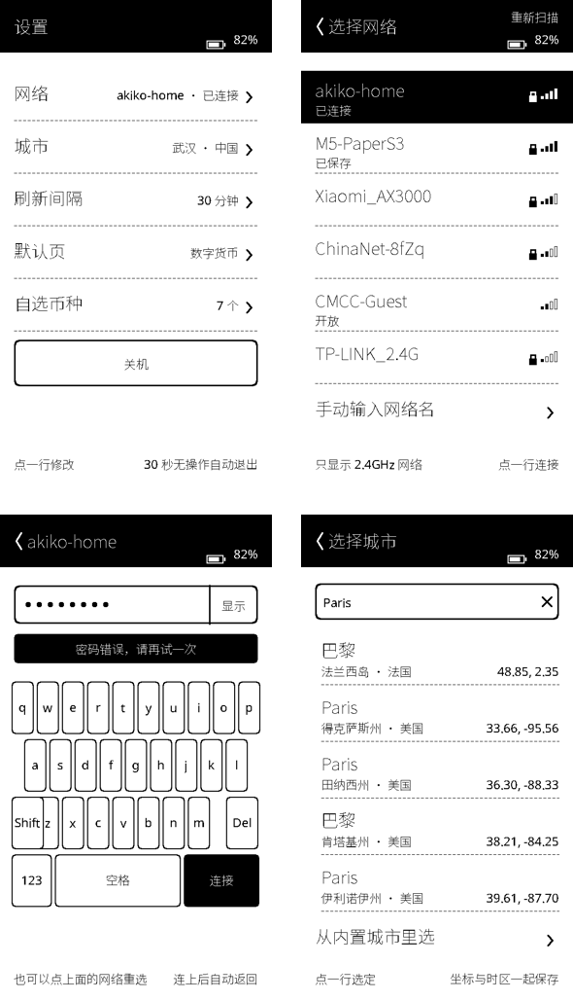
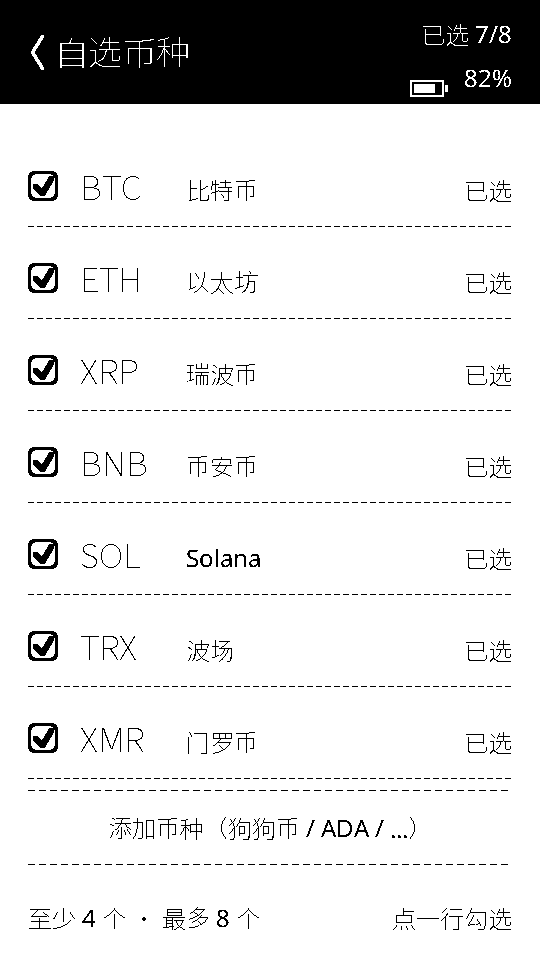

# Xteink X4 天气站固件（深睡省电版）

一个跑在 **Xteink X4（ESP32-C3，800×480 电子墨水屏）** 上的天气固件，基于
[FreeInk SDK](../freeink-sdk) 开发：醒来 → 连 WiFi → 取回**武汉**的当前天气和未来
三天预报 → 以 **480×800 竖屏**渲染并整屏刷新 → 关射频、关面板、进入 **deep sleep**，
**30 分钟**后由 RTC 定时器唤醒，如此循环。深睡期间墨水屏保持最后一帧画面；
按一下电源键立刻唤醒并进入**交互会话**，左右键可在**数字货币 / 当前 / 逐小时 / 空气质量**四页之间切换，
长按电源键则关机。定位只要写城市名（Open-Meteo geocoding 自动解析坐标），
第一页是 BTC/ETH/XRP/BNB/SOL/TRX/XMR 对美元的价格、24 小时涨跌与 7 天走势，
顶部黑条右侧常驻**日期与电池电量**。



> 上图由 `tools/preview/render.sh` 在电脑上渲染真实 UI 代码得到（不是设计稿），
> 像素级等同于固件画出来的画面。

---

## 1. 一个唤醒周期做了什么

| 阶段 | 行为 |
|---|---|
| 唤醒 | RTC 定时器（默认 30 分钟），或按下电源键（GPIO3）提前唤醒 |
| 联网 | STA 模式连 WiFi；刷完立刻 `WiFi.disconnect(true)` + `WiFi.mode(WIFI_OFF)` |
| 取数 | 一次 HTTPS GET `api.open-meteo.com`（免费、无需 API Key），同时拿到实况 + 3 天日预报 |
| 解析 | SDK 自带的 `StreamingJsonParser`（JsonSax，流式、零 DOM、不依赖 ArduinoJson） |
| 显示 | 竖屏 480×800 版式：顶部黑底标题栏（城市 + 日期星期）、天气图标、大号温度、天气状况、体感/湿度/风速、未来三天三行列表、底部“更新于 HH:MM” |
| 刷新 | 整屏 `FULL_REFRESH`（天气屏是静态画面，全刷最干净、没有残影） |
| 深睡 | 面板进 DSLP → 保持电池锁存 → 关射频、隔离 GPIO → `esp_deep_sleep_start()` |

几个省电/体验上的细节：

- **醒来不白刷一次**：屏幕上已经有上一轮的画面，所以唤醒后先取数、再刷一次；
  只有冷启动（屏幕空白）才先画“正在连接 WiFi”占位画面。每次唤醒只花一次刷屏时间（约 2 s）。
- **失败不丢数据**：上一次成功的数据存在 **RTC memory** 里，醒来取数失败时会重画缓存数据
  + 底栏“获取失败 HH:MM，显示上次数据”，而不是退回“暂无数据”。
- **失败早重试**：取数失败 5 分钟后再试（`WEATHER_RETRY_MINUTES`），成功则回到 30 分钟。
- **时间不会漂**：深睡期间 RTC 继续走时，每次醒来还会重新 SNTP 对时，底栏时间始终准。

## 2. 按键与四个页面

屏幕有四页，**数字货币在前、天气在后**，左右键翻页，页号显示在底栏右侧（如 `2/4`）。
顶部黑条右侧固定显示**日期 + 电池电量**（16 级量化的电量条 + 百分比）。

| 按键 | 作用 |
|---|---|
| 电源键（短按） | 从深睡唤醒，并进入交互会话 |
| 左 / 右 | 上一页 / 下一页 |
| 上 / 下 | 在行情页切换排序（表序 → 涨幅榜 → 跌幅榜），其它页同左/右 |
| 确认 | 立刻重新联网取数（不必等下一轮） |
| 返回 | 结束会话，马上休眠 |
| 电源键（长按 2.5 s） | 关机：电池供电时真的断电；USB 供电时进入“关机＝深睡”，再按电源键唤醒 |

**第 1 页 · 数字货币**（BTC / ETH / XRP / BNB / SOL / TRX / XMR 兑美元，24 小时涨跌 + **7 天走势小折线**）



在行情页按**上/下**切换排序（表序 → 涨幅榜 → 跌幅榜，选择会记住），效果：


**第 2 页 · 当前 + 三天**（天气主画面）


**第 3 页 · 未来 12 小时**（时刻 / 图标 / 天气 / 降水概率（>0 才显示）/ 气温）



**第 4 页 · 空气质量**（欧洲 AQI + 六段色阶 + PM2.5 / PM10 / 臭氧 / 二氧化氮）



- 价格带千分位、小数位自适应；▲▼ 表示 24 小时方向；折线框里的虚线是 7 天前的开盘价（基准线）；
- **两个源分工**：价格与 24 小时涨跌来自 **CoinLore**（`/api/ticker/?id=...`，**一个请求拿全 7 个币**，
  含 XMR）；7 天走势来自 **Gate.io** 现货 4 小时 K 线（`/api/v4/spot/candlesticks`，**一个币一个请求**，
  42 根 ≈ 7 天）。和空气质量一样**只在翻到该页时才请求**；
- XMR 没有走势：能裸连到的交易所里，Binance 已于 2024 年退市 XMR（K 线是陈旧的），Gate 没有这个币对，
  所以它的行显示价格与涨跌 + 「无走势」——**宁可不画，也不画错**；
- 想换币种或数据源：改 `src/WeatherData.cpp` 的 `kCoins` 表（符号 / 中文名 / CoinLore id / Gate 币对）
  与 `WeatherClient::fetchCrypto()` 的 URL，解析器不用动。

### 电池电量

顶部黑条右侧是**电量条 + 百分比**，每轮唤醒读一次：

- X4 的电池电压走 **ADC**（`BoardProfile.batteryAdc`，2:1 分压），SDK 的 `BatteryMonitor`
  用一条标准 1S 锂电放电曲线换算成百分比；
- 百分比是 **10% 的整数倍**——电压分辨不出更细，硬要显示到 1% 只会得到来回跳的数字
  （SDK 的原话，我照做了）；
- X4 没有充电状态脚、也没有 I²C 电量计（`batteryChargeStatus = PIN_UNASSIGNED`、`NO_GAUGE`），
  所以**不显示充电中**；读不到时那一行就不画（而不是画 0%）。

> **数据源是按"设备能不能直连"挑的，不是按名气。** 开发这台 Mac 走代理
> （`127.0.0.1:3067`，TUN 模式），ESP32-C3 没有代理，所以**在 Mac 上 curl 通 ≠ 设备通**。
> 固件里做过一次**从设备侧发起**的探针测试，结论：
>
> | 源 | 设备侧结果 |
> |---|---|
> | CoinLore | ✅ HTTP 200 |
> | Gate.io | ✅ HTTP 200 |
> | Binance Vision | ✅ HTTP 200（但 XMR 数据陈旧） |
> | CoinCodex | ❌ HTTP 403（Cloudflare 拦，换 UA / 换请求头都没用） |
> | CoinGecko / OKX / MEXC / HTX / Kraken / CoinCap | ❌ 连接失败 |
>
> 以后换源请这样验：`curl --noproxy '*' <URL>`（不加 `--noproxy` 测的是代理，不代表设备）。

## 3. 真机实测与功耗

已经在真机上跑过（Xteink X4 / ESP32-C3 QFN32 rev v0.4 / 16 MB flash / USB-Serial-JTAG）。

**冷启动一轮（第一次烧录后）：**

```
[weather] Xteink X4 weather station, wake #1 (power-on/reset), clock 10:00  ← 时钟跨深睡保留（这行按 UTC 打印）
[4424]    Wait complete: refresh (3726 ms)         ← 占位画面 + 一次整屏刷新
[weather] refreshing (wake #1, heap 194900 B free)
[weather]  28.4 C, code 1, 3 day(s)                ← 真机取到武汉：28.4 °C 少云，3 天预报
[18702]   Wait complete: refresh (3727 ms)         ← 天气画面（整屏刷新实测 3.7 s）
[weather] deep sleep 30 min (wake mask 0x8, wake #1)
```

**深睡 → 定时唤醒循环**（1 分钟诊断版；`tools/watch_sleep_cycles.py` 被动观察端口节点，
全程不打开串口，所以没有任何干扰）：

```
t+  65.3s  port UP      ← 定时器唤醒
t+  73.7s  port down    （醒着 8.4 s = 启动 1 s + 联网取数 ~4 s + 整屏刷新 3.7 s）
t+ 133.8s  port UP
t+ 142.5s  port down    （醒着 8.7 s）
t+ 202.9s  port UP
t+ 211.0s  port down    （醒着 8.1 s）
cycle period ≈ 68.6 s = 60 s 深睡 + 8.6 s 活跃
```

所以：**深睡、电池锁存保持、RTC 定时唤醒、时钟跨深睡保持**都验证通过；每次唤醒只刷一次屏
（只有冷启动才多一次占位画面）。

生产版（30 分钟）也确认过：面板底部的「更新于 HH:MM」每半小时跟着变——即整机在正常供电下
按时醒来、联网取数、刷新画面、再睡回去。这条不依赖串口，是最终用户能看到的证据。

**按键与会话（实机验证 ✓）**：电源键唤醒进入会话 → 左右键 `1/3 → 2/3 → 3/3` 翻页
（空气质量页首次进入时按需抓数）→ 返回键立刻休眠 → 长按电源键 2.5 s 关机、再按电源键开机，都正常。
串口日志同时确认了 `deep sleep 30 min (wake mask 0x8, page 0, wake #1)`：唤醒掩码只有电源键
（GPIO3），翻页选择的页号也随睡眠保留。

| 项目 | 每天 | 说明 |
|---|---|---|
| 48 次唤醒 × ≈9 s | ≈ 12 mAh | 按活跃平均 100 mA 估，主要开销 |
| 深睡 23.6 小时 | ≈ 2–5 mAh | ESP32-C3 deep sleep ≈ 5 µA + 面板 DSLP + LDO 静态 |
| 合计 | ≈ 15 mAh/天 | 650 mAh 电池大致 **1 个月以上（乐观 5–6 周）** |

活跃电流是估值（WiFi 发射有 200–300 mA 尖峰），实际续航还取决于信号强度、路由器、
刷新间隔和电池容量。想更省就加大 `WEATHER_REFRESH_MINUTES`。

交互会话是唯一"按需多花电"的地方：25 秒会话本身约 0.7 mAh（WiFi 保持连着，好让确认键/空气质量/行情即点即取；
行情那 7 个请求（1 报价 + 6 K 线）大约多花 3–4 s），
折合每天用 10 次也才 ~7 mAh。把 `WEATHER_INTERACTIVE_SECONDS` 调小或设 0 就能省掉。

### 调试深睡设备的两个坑（都踩过了）

1. **打开这个 USB-JTAG 串口会复位芯片。** 抓日志的脚本若"端口一消失就重开"，就会在每次
   唤醒时把芯片复位，串口里满是 `rst:0x15 (USB_UART_CHIP_RESET)` / `wake #1 (power-on/reset)`，
   看起来像"固件从不睡觉"（第一版抓包脚本就是这样）。测唤醒周期请用被动观察：
   `tools/watch_sleep_cycles.py`（只 `stat` 端口，不打开）。
2. **深睡瞬间 USB 断电，最后几行日志经常丢。** "刷屏完成 / deep sleep N min" 这两行常常来不及
   送出，所以判断"睡没睡"要看端口节点是否消失（用第 1 条的工具），而不是看日志。
3. **反复 attach/detach 会把 macOS 的 USB 枚举搞卡。** 设备一分钟醒一次时，串口节点会不停
   出现/消失；折腾几十轮之后 macOS 可能就再也不枚举它了（面板照常刷新，`/dev/cu.usbmodem*`
   却一直不出现）。换个 USB 口 / 换根线 / 重启 `usbd` 即可恢复，设备本身没问题。

## 4. 硬件与依赖

- **Xteink X4**（ESP32-C3 + SSD1677 800×480，FreeInk 里的 `XTEINK_X4` profile）。
  屏幕引脚、按键、电源锁存全部由 SDK 的板级 profile 提供，固件里没有硬编码引脚。
  实测机型：ESP32-C3 (QFN32) rev v0.4，16 MB flash，USB-Serial/JTAG。
- [FreeInk SDK](../freeink-sdk)（本仓库默认从同级目录 `../freeink-sdk` 读取）：
  `BatteryMonitor` / `BoardConfig` / `EInkDisplay` / `PowerManager` / `FreeInkUI` / `JsonSax`
- [PlatformIO Core](https://docs.platformio.org/en/latest/core/index.html)（`pio`）；
  `platformio.ini` 使用 pioarduino 的 Arduino-ESP32 3.3.x 平台包

编译结果：Flash 约 1.27 MB / 4 MB 应用分区（30%），RAM 约 42 KB / 320 KB（13%）。
分区表见 `partitions.csv`（4 MB 应用 + 11.9 MB storage，无 coredump 分区，
免得开机打印 OEM 残留的 `Incorrect size of core dump image`）。

## 5. 快速开始

```sh
# 1) 填 WiFi（推荐放进 include/secrets.h，已被 .gitignore 忽略）
cat > include/secrets.h <<'EOF'
#define WIFI_SSID     "你的 WiFi 名"
#define WIFI_PASSWORD "你的 WiFi 密码"
EOF

# 2) 位置默认已是武汉（30.5928, 114.3055）；要改就动 include/config.h

# 3) 编译 & 烧录（USB-C 连上 X4）
pio run
pio run -t upload
pio device monitor          # 115200；每轮唤醒都会打印日志
```

> 如果 `~/.platformio` 不可写，把 PlatformIO 的包目录放到工作区里再执行：
> `PLATFORMIO_CORE_DIR=$PWD/../.pio-core pio run`

**⚠️ 深睡时串口会“消失”，这是正常的。** ESP32-C3 进 deep sleep 会把 USB Serial/JTAG 断电，
所以 `/dev/cu.usbmodemXXXX` 只在醒来那 15–20 秒里存在，`pio device monitor` 会断连重连，
`pio run -t upload` 也常常报 `port doesn't exist`。三条实用路径：

```sh
# A) 已经醒着（刚上电/刚按过电源键）：直接烧 + 抓 60 s 日志
tools/flash_and_watch.sh /dev/cu.usbmodem201301 60 x4weather

# B) 不想掐时间：轮询端口，一出现立刻用 esptool 直烧（跳过 PlatformIO 的构建检查，
#    连接稳稳落在窗口内；一旦进入 stub flasher，芯片就不再执行固件、也不会中途睡回去），
#    顺带擦掉 coredump 分区，烧完自动抓日志到 build/flash_when_awake.log
tools/flash_when_awake.sh /dev/cu.usbmodem201301 x4weather_1min 2700 220

# C) 只想快速验证深睡→定时唤醒循环：1 分钟间隔的诊断固件
pio run -e x4weather_1min -t upload

# D) 全流程真机验证（1 分钟版看循环 → 烧回 30 分钟版 → 被动确认它在睡）
tools/verify_on_device.sh /dev/cu.usbmodem201301

# E) 被动测量唤醒周期（只 stat 端口，不打开，绝不会复位芯片）
tools/watch_sleep_cycles.py --port /dev/cu.usbmodem201301 --seconds 240

# F) 只看日志不烧录：等下一次唤醒窗口，单次打开读 45 秒
tools/watch_console.sh /dev/cu.usbmodem201301 45 3600
```

按一下电源键（或重新插拔 USB）就能立刻唤醒设备，不用等下一次定时唤醒。
抓日志时**不要循环重开串口**（会复位芯片，见第 3 节的两个坑）。

## 6. 竖屏是怎么做的

面板原生是 800×480 横向。FreeInk 的 SSD1677 驱动只做镜像（X/Y flip），不做 90° 转置；
但 SDK 的 UI 层 `freeink::ui::DisplayTarget` 会在**每个像素写入时**把逻辑坐标旋转进面板
原生 framebuffer，所以固件只按 480×800 竖屏排版即可：

```cpp
// main.cpp：横向面板（width > height）默认就是 Portrait（顺时针 90°）
freeink::ui::DisplayTarget target(display.getFrameBuffer(),
                                  display.getDisplayWidth(),   // 800
                                  display.getDisplayHeight(),  // 480
                                  display.getDisplayWidthBytes());
```

- 想反向竖屏（比如习惯左手持机）：构造时显式传 `freeink::ui::Orientation::PortraitInverted`。
- 想临时看横屏版式：传 `Orientation::LandscapeCounterClockwise`（原生方向）。
- 若真机上整屏看起来上下颠倒，改的就是这一个枚举值（`src/main.cpp`），不需要动任何布局代码。

## 7. 深睡与唤醒细节

**为什么深睡还能保持供电？** X4 的 GPIO13 是电池 MOSFET 的锁存脚（`BoardConfig` 里
`power.latch0`）。刷完屏后固件先把锁存脚拉高并 `gpio_hold_en()`，再调用 SDK 的
`PowerManager::deepSleep()`（内部 `gpio_deep_sleep_hold_en()` 让保持生效、并隔离其余悬空
GPIO），所以定时器到点时整机还在供电、能正常唤醒。若有机器不自动醒，先看串口日志里
`deep sleep N min (wake mask 0x..)` 这行有没有打出来。

**唤醒源**

| 来源 | 触发 | 处理 |
|---|---|---|
| RTC 定时器 | 每 `WEATHER_REFRESH_MINUTES`（默认 30 分钟） | 正常刷新 |
| 电源键 GPIO3 | 按下（低电平） | 立刻刷新一次 |
| 上电/复位 | 冷启动 | 先画占位画面再刷新 |

**为什么只有电源键能唤醒？** C3 的深睡 GPIO 唤醒源只覆盖 RTC 能力引脚 GPIO0~5，而
X3/X4 的导航键挂在 **ADC 电阻梯**上（`BoardConfig::ACTIVE.inputStyle == XteinkAdcLadder`），
按下键是分压电压而不是干净的低电平，用“电平唤醒”不可靠，所以导航键不加进唤醒掩码；
数字按键板（X4 Pro / X4 Classic）上固件会自动把 6 个导航键一起加入掩码。要完全关掉按键
唤醒，把 `include/config.h` 里的 `WEATHER_WAKE_ON_BUTTON` 设为 `0`（若发现设备会自己醒来，
多半是按键悬空/干扰，关掉即可）。

## 8. 天气数据与刷新策略

四个接口（`src/WeatherClient.cpp`）：天气每轮请求，另外三个按需。天气：

```
https://api.open-meteo.com/v1/forecast
  ?latitude=30.5928&longitude=114.3055      # 武汉
  &current=temperature_2m,relative_humidity_2m,apparent_temperature,is_day,weather_code,wind_speed_10m
  &hourly=temperature_2m,weather_code,precipitation_probability&forecast_hours=12
  &daily=weather_code,temperature_2m_max,temperature_2m_min
  &timezone=auto&forecast_days=3
```

定位（只在第一次开机、或城市名变了时请求一次，结果存 RTC memory）：

```
https://geocoding-api.open-meteo.com/v1/search?count=1&format=json&name=Wuhan
  → {"results":[{"name":"Wuhan","latitude":30.58333,"longitude":114.26667,
                 "timezone":"Asia/Shanghai","country":"China", ...}]}
```

空气质量（按需，翻到该页才请求）：

```
https://air-quality-api.open-meteo.com/v1/air-quality
  ?latitude=30.5833&longitude=114.2667
  &current=european_aqi,pm2_5,pm10,nitrogen_dioxide,ozone&timezone=auto
```

行情（按需，翻到该页才请求；两个源，共 7 个请求）：

```
# 7 个币的价格与 24 小时涨跌：CoinLore，一个请求（约 2.5 KB）
https://api.coinlore.net/api/ticker/?id=90,80,58,2710,48543,2713,28
  → [{"id":"90","symbol":"BTC","price_usd":"83619.93","percent_change_24h":"-0.27", ...}, ...]

# 每个币的 7 天走势：Gate.io 现货 4 小时 K 线，42 根（约 4 KB）
https://api.gateio.ws/api/v4/spot/candlesticks?currency_pair=BTC_USDT&interval=4h&limit=42
  → [["1791273600","117997889.14","86242.3","86377.6","85555.8","85561.5", ...], ...]
                 ↑时间戳        ↑成交额     ↑收盘（数组第 3 个）
```

K 线的字段全是**字符串**，解析时按位置取第 3 个当收盘价，整条序列存成「相对首个收盘价的 0.01%」
int16（42 点刚好放进 RTC 缓存），画图与极值都用它。价格与涨跌**只认 CoinLore**，
K 线不覆盖它们——两个源的报价可能差一点点，混着用会闪。

- `timezone=auto`：日预报的日期和 `current.time` 都是**当地时间**，固件只做格式化。
- 时间来自 SNTP（`configTzTime`，时区字符串见 `WEATHER_TIMEZONE`，默认 `"CST-8"`），
  没同步上就显示 `--:--`，不影响天气显示。
- WMO 天气码 → 中文文案与图标的分组在 `WeatherData.cpp::conditionText()/conditionIcon()`
  （晴 / 少云 / 多云 / 阴 / 雾 / 毛毛雨 / 小雨 / 中雨 / 大雨 / 阵雨 / 冻雨 / 雪 / 雷阵雨 …）。
- **TLS 说明**：默认 `secure.setInsecure()`（不校验证书）——ESP32 在 SNTP 同步前没有可信时钟，
  工程里也没装 CA bundle，而天气数据是公开信息。要严格校验的话，把
  `WeatherClient.cpp` 里的 `setInsecure()` 换成 `secure.setCACert(root_ca_pem)` 即可。

## 9. 目录结构

```
x4-weather/
├── platformio.ini              # env：x4weather（正式）+ x4weather_1min（1 分钟诊断）
├── partitions.csv              # 16 MB 布局：4 MB 应用 + 64 KB coredump + 11.8 MB storage
├── include/
│   ├── config.h                # WiFi 兜底值、武汉经纬度、时区、刷新/重试/唤醒开关
│   ├── WeatherData.h           # 数据模型 + WMO 天气码 → 中文/图标映射
│   ├── WeatherParse.h          # Open-Meteo JSON 解析（纯 C++，可在 PC 上跑测试）
│   ├── WeatherClient.h         # WiFi + HTTPS 客户端接口
│   ├── WeatherUi.h             # 480×800 竖屏版式接口（不依赖 Arduino）
│   ├── CjkGlyphSource.h        # FreeInkUI RuntimeGlyphSource：中文/°C 字形回退
│   └── fonts/                  # 全部由脚本生成的位图字体与图标（见第 12 节）
├── src/
│   ├── main.cpp                # 唤醒周期、深睡/唤醒、锁存与面板电源、刷新策略
│   ├── WeatherClient.cpp       # WiFi/SNTP + HTTPS GET
│   ├── WeatherParse.cpp        # JsonSax 流式解析（固件与测试共用同一份代码）
│   ├── WeatherData.cpp         # 天气码文案、日期/时间/温度格式化
│   ├── WeatherUi.cpp           # 竖屏版式（可在 PC 上编译，见第 12 节）
│   └── CjkGlyphSource.cpp
├── tools/
│   ├── gen_all.sh              # 一键重生成字体 + 图标
│   ├── test_host.sh            # 主机端：解析测试 + 渲染三种界面状态
│   ├── flash_and_watch.sh      # 设备醒着时：烧录 + 抓串口日志（单次打开，不复位芯片）
│   ├── watch_console.sh        # 只抓日志不烧录：等唤醒窗口，单次打开读 N 秒
│   ├── flash_when_awake.sh     # 深睡中：轮询端口，一出现就用 esptool 直烧，再抓日志
│   ├── verify_on_device.sh     # 全流程真机验证（诊断版 → 正式版 → 被动观察）
│   ├── watch_sleep_cycles.py   # 被动测唤醒周期：只 stat 端口，不打开串口
│   ├── gen_fonts.py            # 扫描源码里的中文字符串 → 中文字形位图
│   ├── gen_icons.py            # 天气图标（Pillow 画矢量 → 4× 超采样 → 二值化）
│   ├── charset_extra.txt       # 额外字符（城市名等）
│   ├── fonts/README.md         # 字体来源与许可
│   └── preview/                # 主机端渲染预览（render.sh / to_png.py / 测试 / 真实响应快照：
│                               #   天气、空气质量、geocoding、CoinLore 报价、6 份 Gate K 线）
└── docs/                       # README 用的预览图
```

## 10. 常用配置（`include/config.h`）

| 宏 | 默认 | 作用 |
|---|---|---|
| `WEATHER_CITY` | `"Wuhan"` | 用于 geocoding 的城市名（中英文皆可；空 = 不 geocoding） |
| `WEATHER_PLACE` | `"武汉"` | 标题栏地名；留空 `""` 则用 geocoding 返回的名字 |
| `WEATHER_LATITUDE` / `WEATHER_LONGITUDE` | `30.5928` / `114.3055` | geocoding 失败时的兜底坐标 |
| `WEATHER_REFRESH_MINUTES` | `30` | 深睡时长 = 刷新间隔 |
| `WEATHER_RETRY_MINUTES` | `5` | 取数失败后的重试间隔 |
| `WEATHER_WAKE_ON_BUTTON` | `1` | 是否允许按键唤醒（只有电源键能唤醒，导航键在电阻梯上） |
| `WEATHER_INTERACTIVE_SECONDS` | `25` | 电源键唤醒后保持醒着多久供切页；设 `0` 关闭交互（按一下只刷新就睡） |
| `WEATHER_POWER_OFF_HOLD_MS` | `2500` | 长按电源键关机阈值 |
| `WEATHER_FORECAST_HOURS` | `12` | 逐小时页取回/显示多少小时 |
| `WEATHER_TIMEZONE` | `"CST-8"` | 本地时区（POSIX TZ 字符串） |

这些宏都用 `#ifndef` 包着，所以可以用构建参数覆盖（诊断 env `x4weather_1min` 就是这么做的，
不改代码就能把间隔改成 1 分钟）。

## 11. 中文、字体与图标都是生成的

FreeInkUI 自带的位图字体只覆盖 `U+0020..U+007E`（西文），所以：

1. `tools/gen_fonts.py` 用 **Noto Sans SC**（OFL 许可）生成三套东西：
   - `WeatherTitleFont.h`：34 px 西文（标题栏、区块标题）
   - `WeatherDigitsFont.h`：112 px 数字/符号（大号温度）
   - `WeatherCjkFont.h`：**稀疏**字形表（24 px / 34 px 各一份），由
     `weather::CjkGlyphSource` 通过 `DisplayTarget::setGlyphFallback()` 挂上，
     UI 里中英文混排会按 slot 的字号自动切换、基线对齐
2. 字符集**只扫描字符串字面量**（注释不算，不白占 flash）：`src/`、`include/`、
   `tools/preview/` 里出现的所有中文字符串都会被烘进位图——包括 `config.h` 里的
   `WEATHER_PLACE "武汉"`，所以改地名不会出现“豆腐块”
3. 城市名这类需要预先准备、暂时没写进源码的字，写进 `tools/charset_extra.txt`
   （文件里已预置常见城市名）；若某个字符在字体里找不到，生成脚本会直接报错退出
4. 改完文案或图标后重新生成：

```sh
tools/gen_all.sh
```

`tools/fonts/README.md` 里有源 TTF 的下载命令；生成出来的 `include/fonts/*.h`
已经提交，日常编译不需要 TTF。

## 12. 不用板子也能验证（主机测试 + 预览）

`tools/test_host.sh` 跑两件事，都不需要开发板、也不需要 PlatformIO：

```sh
PREVIEW_PYTHON=/path/to/python sh tools/test_host.sh
```

1. **解析测试**：`tools/preview/test_parse.cpp` 用真实的 Open-Meteo 响应
   （`tools/preview/sample_response.json`，固件请求的那条 URL 对武汉的真实返回快照）驱动
   `weather::parseForecast()`——固件里跑的就是同一份 `src/WeatherParse.cpp`。
   覆盖：实况字段、三天下限/上限、逐小时 12 条、空气质量、行情（报价 → 价格/24 小时变化、
   K 线 → 42 点走势与极值、**单币响应只填该币不动其它币**、未知币种被拒）、geocoding、
   价格与涨跌格式化，以及截断/缺 `current`/空载荷/只回一半币种/零价格 K 线等坏载荷
   被拒绝且**不污染上一次数据**。
2. **渲染预览**：编译**和固件完全相同**的 `WeatherUi.cpp` + `CjkGlyphSource.cpp` +
   FreeInkUI 的 `DisplayTarget`，往模拟的 800×480 framebuffer 上画。`ok` 这一档会把
   录制下来的响应**过一遍同一个解析器**再渲染，所以预览图上的数字（28.4 °C / 少云 /
   体感 29.5° …）就是真机当时显示的内容——和实机日志里的 `28.4 C, code 1` 完全对得上。

```sh
sh tools/preview/render.sh ok                         # 第 2 页：当前 + 三天
sh tools/preview/render.sh hourly                     # 第 3 页：未来 12 小时
sh tools/preview/render.sh aqi                        # 第 4 页：空气质量
sh tools/preview/render.sh crypto                     # 第 1 页：数字货币（表序）
sh tools/preview/render.sh crypto-gainers            # 行情页：涨幅榜
sh tools/preview/render.sh ok "" "" "" 15            # 最后一档参数是表头电量（负数=不显示）
sh tools/preview/render.sh busy                       # 冷启动联网中的占位画面
sh tools/preview/render.sh error                      # 取数失败
sh tools/preview/render.sh ok /tmp/other.json /tmp/air.json   # 换数据源渲染
# build/preview/<variant>_portrait.png  持机竖看（= 用户看到的画面）
# build/preview/<variant>_native.png    面板原生扫描方向（= framebuffer 内容）
```

四份数据（天气含逐小时、空气质量、行情、geocoding）都来自 `tools/preview/sample_*.json` 里的真实响应快照，
并且都会**过一遍固件同一个解析器**再画——所以预览图上的数字就是真机上的数字。

## 13. 之后可以怎么加

- **长按电源键关机**：醒来时读 GPIO3，长按 > 3 s 就把锁存脚拉低断电（SDK 的
  `PowerManager::waitForPowerButtonRelease()` 可以复用）。
- **严格 TLS**：把 `secure.setInsecure()` 换成 `secure.setCACert(...)` 固定根证书。
- **按城市名自动定位**：Open-Meteo 还有 geocoding 接口
  （`geocoding-api.open-meteo.com/v1/search?name=...`），可以把经纬度改成城市名查询。
- **缩短联网段**：现在每轮约 10 s 花在 WiFi + SNTP + TLS 上；可以按 RSSI 调低发射功率、
  固定 BSSID/信道、或把 SNTP 只在时钟丢失时启用（现在已经是“已有时钟就不等”）。
- **运行时 TTF 中文字体**：SD 卡放一份 TTF，用 FreeInkFont / `TtfGlyphSource` 做字形回退，
  就不必预烘字符集（现在是预烘，省 RAM、省 SD 依赖，代价是城市名要进 `charset_extra.txt`）。
- **多页 UI**：既然按键能唤醒，也可以做“按键切页看逐小时/空气质量”，
  SDK 的 FreeInkUI 已经提供了 Tab、列表、对话框等组件。

## 14. 常见问题

| 现象 | 处理 |
|---|---|
| 画面上下颠倒 | 改 `src/main.cpp` 里 `DisplayTarget` 的 orientation（`PortraitInverted`） |
| 地名显示成方块 | 把字加到 `tools/charset_extra.txt`，跑 `tools/gen_all.sh`（脚本会校验覆盖） |
| `pio run -t upload` 报 `ModuleNotFoundError: No module named 'littlefs'` | pioarduino 平台的 `builder/main.py` **顶层**就 `from littlefs import …`（还有 `fatfs`、`yaml`），而 pio 自带的解释器可能缺这几个包（Homebrew 装的 PlatformIO 上尤其常见，安装时它们还被放错过目录）。两条路任选：<br>① 用自带 penv 的 core 目录（本仓库的 `.pio-core` 就是）：`PLATFORMIO_CORE_DIR=$PWD/../.pio-core pio run -t upload`；<br>② 直接给 pio 用的解释器补包：<br>`$(head -1 "$(command -v pio)" | sed 's/^#!//') -m pip install littlefs-python fatfs-ng pyyaml` |
| `pio run -t upload` 报端口不存在 | 深睡时 USB 会断电消失，属正常：按电源键唤醒后立刻烧，或用 `tools/flash_when_awake.sh` |
| upload 打开了蓝牙耳机之类的串口 | PlatformIO 默认取**第一个** `/dev/cu.*`，Mac 上常常是蓝牙音频端点。本工程的 `tools/pio_upload_port.py`（`extra_scripts`）会自动锁定 `/dev/cu.usbmodem*`；要手动指定就 `--upload-port /dev/cu.usbmodem201301` |
| `pio device monitor` 老是断开重连 | 同上，每轮唤醒 USB CDC 都会重新枚举 |
| 一直“无法连接 WiFi” | X4 只支持 2.4 GHz；确认 `include/secrets.h` 里的账号密码 |
| 深睡后不自动醒 | 看串口有没有 `deep sleep N min` 日志；确认电量，以及 `WEATHER_REFRESH_MINUTES` 不为 0 |
| 设备频繁自己醒来 | 多半是按键悬空/干扰，把 `WEATHER_WAKE_ON_BUTTON` 设为 `0` |
| 唤醒后还是旧数据 | 底栏会写“获取失败 …，显示上次数据”；检查网络，5 分钟后自动重试 |
| 行情页写“行情获取失败” | 看串口日志：`crypto quotes HTTP -1` = 连不上（换源，见上文的设备侧可达性表）、`403` = 被 Cloudflare 拦、`200` 但币数 0 = 响应格式变了。XMR 那行写“无走势”是正常的 |
| 想让自己电脑当代理给设备用 | 现在的 ESP-IDF/Arduino TLS 栈**没有代理支持**（`esp-tls` 里没有 proxy 字段），要让设备走 HTTP CONNECT 代理得自己用 mbedTLS 手写隧道（约 150 行）；本项目的做法是**选裸连可达的数据源**，不需要代理 |
| 编译报找不到 `../freeink-sdk` | 改 `platformio.ini` 里 5 个 `symlink://` 路径指向你的 SDK checkout |

## 15. PaperS3（ESP32-S3 + 触控）移植

目标机型 **M5Stack PaperS3**：ESP32-S3R8（16 MB flash / 8 MB OPI PSRAM）、
ED047TC1 960×540 16 级灰度、8-bit 并行总线、**GT911 触控、没有任何可读按键**
（侧键直接进 PMS150G 电源锁存芯片）。SDK 里已有 `M5PAPER_S3` 板级 profile。

### 已完成的硬件校准（`[env:papers3_bringup]`）

SDK 文档给 PaperS3 标了三项 "pending hardware validation"，一次烧录全部实测完毕：

| 项 | 结论 | 实测数据 |
|---|---|---|
| 面板方向 | ✅ profile 正确 | 逻辑帧 **540×960 竖屏**（960×540 面板 + Portrait 旋转），屏幕上"上"箭头位置正确 |
| GT911 轴映射 | ✅ profile 正确 | 点四个角 → 逻辑坐标 `(38,317)/(496,316)/(40,919)/(500,923)`，与屏幕标签位置吻合 |
| 电池分压 | ✅ 可用 | **4178 mV → 100%**，`charging=1`（能显示"充电中"；X4 没有这个能力） |
| 刷新耗时 | ✅ 比 X4 快 | FULL **1098 ms**（X4 3726）· HALF 1098 ms · FAST **562 ms**（X4 503）· 无变化 440 ms |
| 输入设备 | 触控专用 | `hasTouch=1`，GT911 在 0x5D（备用 0x14），多点支持 |
| 其它差异 | — | 无电源锁存（关机 = GPIO44 脉冲串）；触控 INT(GPIO48) **不是 S3 的 RTC IO**，深睡只能定时唤醒，交互要用"浅睡 + GPIO 唤醒"窗口 |

复现：`pio run -e papers3_bringup -t upload`，然后 `pio device monitor`；
它会打印板级事实、电池、三种刷新的耗时，并把每次触控的
面板坐标→归一化→逻辑坐标→象限打出来；点哪个角，屏幕上那个角会变黑块。

### 骨架已在真机跑通（`[env:papers3]` / `[env:papers3_bench]`）

同一份 `src/main.cpp` 编译出两个板子的固件，只有显示、输入与电源三处按板子分叉：

- **画布缩放**：`include/ScaledDrawTarget.h` 是一个 `DrawTarget` 装饰器，把 X4 的 480×800 版式
  按 1.125× 居中映射进 PaperS3 的 540×960 竖屏逻辑帧 —— `WeatherUi.cpp` 一行没改，
  X4 的 7 张预览渲染图**逐字节不变**（做过字节级回归）；
- **触控**：`interactiveTouchSession()` —— 点左/右半屏翻页、行情页上下滑换排序、
  长按 2.5 秒关机、点底部 80px 立即休眠。触摸坐标经 `touchToLogical()` 归一化映射到逻辑帧；
- **电源**：PaperS3 没有锁存脚也没有可读按键，关机走 `BoardPaperS3::powerOff()` 的脉冲串，
  深睡只有定时唤醒（30 分钟），所以每次唤醒都开一个触控窗口；
- **踩过的两个坑**（都写进 `tools/flash_papers3.sh` 注释）：S3 深睡会关掉 USB 外设、
  端口消失（脚本会等下一次唤醒）；手写 esptool 时若把 flash 模式硬写成 `qio` 而镜像头是 DIO，
  会进 `TG0WDT_SYS_RST` 看门狗重启循环 —— 用 `--flash_mode keep` 并补上 `boot_app0.bin`。

真机实测（`papers3_bench`：30 分钟交互窗口 + 2 分钟刷新）：

```
[weather] m5paper_s3 weather station, wake #1 (power-on/reset), clock 12:33
[weather] layout scaled x1.125 into 540x960 logical frame
[weather] geocoded "Wuhan" -> 30.5833, 114.2667 (Asia/Shanghai, China)
[weather] crypto quotes HTTP 200: 7/7 coins
[weather] BTC 81288 / ETH 2375.34 / XMR 544.11
[weather] touch session (1800000 ms idle timeout, page 0)
[weather] touch (507,388) -> (522,126), 579 ms, d=(15,-262)   → crypto sort: 涨幅榜
[weather] touch (505,268) -> (765,251), 236 ms, d=(260,-17)   → 翻页（水平分量占优）
```


### 省电会话窗口（浅睡 + 触摸中断唤醒）

PaperS3 没有可读按键，交互必须发生在"唤醒后的窗口"里。窗口不能靠全速空转（~30–40 mA），
所以空闲时进**浅睡**、用 **GT911 中断（GPIO48）**唤醒 —— 也就是 M5Unified 的做法
（GPIO48 不是 S3 的 RTC IO，深睡唤醒用不了它，但**浅睡 GPIO 唤醒支持任意引脚**）：

| 供电 | 会话空闲时 | 电流量级 | 为什么 |
|---|---|---|---|
| USB 插着 | 常醒（10 ms 轮询） | ~30–40 mA | USB-Serial-JTAG **熬不过浅睡**，为了日志/烧录必须醒着 |
| 电池供电 | 浅睡（触摸中断 + 1 秒安全切片） | ~1–2 mA | 省电是电池模式下唯一重要的事 |

模式**每个切片重新判定**（`usbPowerPresent()`），所以插拔线能立刻切换，不用重启。

两个实测结论（都属于 SDK 标着 "pending validation" 的项）：

- **`usbDetect` 极性注释是反的**：实测 GPI5 在 `floating / pull-up / pull-down` 三种配置下都读 0
  （被板子主动拉低）→ 对这台机器 **LOW = 插着 USB**，而 profile 注释写的是 HIGH ✗；
- **`isCharging()` 不能单独当"插着"的判据**：电池满电时充电器停充、它变 false 而线还插着
  （SDK 文档警告过）→ 只能当第二票。

真机手势验证（日志逐条可查）：

| 手势 | 实测 |
|---|---|
| 点右/左半屏翻页 | `tap logical (494,514): page 0 -> 1` … `page 3 -> 0` 环形正确 ✓ |
| 行情页上下滑换排序 | `d=(-13,-185)` → `crypto sort: 涨幅榜` ✓ |
| 横滑翻页 | `d=(260,-17)` 水平分量占优 → 翻页而非排序 ✓ |
| 长按 2.5 秒关机 | 设备真断电、屏幕彻底无反应 ✓ |

### 设置界面真机验证（`[env:papers3_bench]`）

数据页**点顶栏**进设置，设置里左上角 ‹ 逐级上退；60 秒无操作自动退出回数据页。
真机日志逐条可查（每次触摸都打印屏名与逻辑坐标，每一步操作都有记录）：

```
[settings] 设置 touch logical=(446,507) → home row 3 → screen -> 默认页
[settings] 设置 touch logical=(461,310) → home row 1 → screen -> 选择城市
[settings] 选择城市 touch logical=(73,199) → city row 0: 武汉      ← 内置城市直接选中（无需联网）
[settings] 设置 touch logical=(446,632) → home row 4 → screen -> 自选币种
[settings] coins tap (52,370) -> row 2, mask 0x3B (5 visible)     ← 取消两个币，掩码精确
```

WiFi 列表按页显示（每页 6 个 + 上下滑翻页 + 底栏页码）；密码键盘有
**小写 / 大写 / 数字符号**三层（`1234567890` / `-_=+()[]{}` / `.,?!@#$%^&*`），
失败时底栏反白提示「密码错误，请再试一次」；连接成功即写入 NVS。
城市既可从**内置 7 城**里点（离线可用），也可以搜索（geocoding 多候选，看省份区分同名城市）。

### 移植计划

| 阶段 | 内容 | 状态 |
|---|---|---|
| 1 | 板级校准（上面那张表） | ✅ 完成 |
| 2 | 骨架：同一套取数/解析层跑在 S3 上 + 触控翻页 + 定时深睡 | ✅ 完成（真机验证） |
| 3 | 版式精修（可选）：行高/字号按触控尺寸调整 + 16 级灰度利用 | 待做 |
| 4 | 设置界面：网络扫描/密码键盘/城市候选/自选币种 | ✅ 完成（真机验证） |
| 5 | 省电模型：定时唤醒 → 取数画完 → 浅睡（触控唤醒）会话窗口 → 深睡 | ✅ 完成（真机验证） |

**可原样复用**（不依赖板子）：`WeatherClient`（WiFi/TLS/HTTP）、`WeatherParse`（SAX 解析）、
`WeatherData`、全部主机测试与预览渲染工具。风险集中在显示、输入与电源三块。

## 16. 触屏版设置界面（真机代码）

设置界面是**真代码**（`include/SettingsUi.h` + `src/SettingsUi.cpp`），不是草图：
九个屏都按 540×960 竖屏原生布局，能直接用主机渲染工具出图（`tools/preview/render.sh settings-*`），
所以在板子上调之前就能确认版式。



| 屏 | 内容 |
|---|---|
| 设置首页 | 网络 / 城市 / 刷新间隔 / 默认页 / 自选币种 五行 + 关机大按钮（点一次变"再点一次确认关机"） |
| 选择网络 | 扫描列表：锁标记 + 四格信号 + 状态（已连接/已保存/开放），当前网络整行反白；末尾"手动输入网络名" |
| 输入密码 | 掩码输入框 + 显示/隐藏 + QWERTY（Shift/Del/123/空格/连接）+ 失败反白条 |
| 选择城市 | **内置 7 城**（武汉/上海/广州/深圳/香港/成都/重庆）+ 坐标 + 当前城市打勾 + "搜索其他城市" |
| 搜索城市 / 选择候选 | 两步：先输入（拼音/英文）+ 键盘，再出候选列表（省份·国家 + 坐标，用于区分同名城市） |
| 自选币种 | 七个币的勾选框 + 已选计数（至少 4 个） |
| 刷新间隔 / 默认页 | 选项列表，当前项打勾 |

数据来自 `Settings`（NVS 覆盖编译期默认值，见第 15 节），城市坐标来自 `CityList`（烤进固件，
所以**配网之前**也能先选城市）。


触屏机上配网/选城市不该再改 `config.h` 重烧固件。下面五张是用**真字体 + 真图元**在 540×960
竖屏逻辑帧上渲染的设计草图（生成器：`tools/sketch/render.sh`，源码 `tools/sketch/render_settings.cpp`）：



- **设置首页**：网络 / 城市 / 刷新间隔 / 默认页 / 自选币种 五行可点，加一个「关机」大按钮；
  底栏提示 30 秒无操作自动退出。刷新间隔与默认页做成列表选择，**只有 24 小时制、只有 ℃**
  （所以设置里不出现这两项）。
- **选择网络**：`WiFi.scanNetworks()` 列表，锁标记 + 四格信号 + 状态（已连接/已保存/开放），
  当前网络整行反白；只显示 2.4GHz（5GHz 的 SSID 扫不到）；末尾一行「手动输入网络名」。
- **输入密码**：掩码输入框 + 「显示」切换 + SDK 的 QWERTY（Shift / Del / 123 / 空格 / 连接），
  失败时用反白条提示「密码错误，请再试一次」；打字走 `InputManager::beginAsync()` 的
  tap 队列，连接阻塞 loop 时也不丢按键。
- **选择城市**：搜索框 + **候选列表**（名称 / 省份·国家 / 坐标），解决同名城市——
  示例就是真实数据：`Paris` 返回巴黎（法国）与四个美国 Paris；末尾「从内置城市里选」是
  没网时的兜底。
- **自选币种**：勾选框多选，至少 4 个、最多 8 个，末尾「添加币种」虚线行。



> 草图是 1bpp（和 X4 一样只有黑白两色）；PaperS3 是 16 级灰度屏，真机上分隔线、次要文字
> 可以画浅灰，观感会更好。关机按钮做的是**软件关机**；侧键长按 2 秒是硬件断电，
> 所以界面卡住时照样能关机。

## 17. 许可与致谢

- 本目录代码：MIT 许可（见 [LICENSE](LICENSE)，与本 SDK 同为 MIT）。
- 位图字体：由 **Noto Sans SC**（SIL OFL 1.1）栅格化而来，仓库内保存的是位图数组。
- 天气图标：`tools/gen_icons.py` 用几何图元现画，无第三方素材。
- 深睡/唤醒的 SoC 差异（C3 的 GPIO 唤醒源 vs Xtensa 的 ext1）由 SDK 的 `PowerManager`
  处理，固件只提供唤醒掩码与刷新间隔。
- 平台与驱动能力来自 [FreeInk SDK](../freeink-sdk)（SSD1677 驱动、板级 profile、
  `DisplayTarget` 旋转与字形回退、JsonSax 解析）。
